# 🧠 CONCODE.WEB — Neural Brain Integrated Web Architecture
## 🌐 Obsidian Web Node Mapping & Knowledge Graph

> **Obsidian Integration**: This document is formatted natively for **Obsidian Graph View**. All nodes use Obsidian bi-directional wikilinks (`[[Node]]`), hierarchical tags (`#type/component`), dynamic state indicators, and inline Mermaid graph visualization.

---

## 🗺️ Master Obsidian Graph Diagram

```mermaid
graph TD
    %% Define Styling
    classDef client fill:#1e1b4b,stroke:#818cf8,stroke-width:2px,color:#fff
    classDef express fill:#064e3b,stroke:#34d399,stroke-width:2px,color:#fff
    classDef python fill:#4c1d95,stroke:#c084fc,stroke-width:2px,color:#fff
    classDef ai fill:#701a75,stroke:#f472b6,stroke-width:2px,color:#fff
    classDef storage fill:#7c2d12,stroke:#fb923c,stroke-width:2px,color:#fff

    subgraph FRONTEND_LAYER ["🌐 Frontend Web UI Layer (Port 3000)"]
        UI_INDEX["[[Index Web Portal]]<br><code>public/index.html</code>"]:::client
        UI_DASH["[[Dashboard Analytics UI]]<br><code>public/dashboard.html</code>"]:::client
        UI_ADMIN["[[Admin Console UI]]<br><code>public/admin.html</code>"]:::client
        UI_AUTH["[[Auth Portal UI]]<br><code>public/login.html</code>"]:::client
        SDK_BRAIN["[[Client Brain SDK]]<br><code>concode_brain_client.js</code>"]:::client
        VOICE_AGENT["[[Voice Assistant Agent]]<br><code>concode-voice-agent.js</code>"]:::client
        VOICE_DISPATCH["[[Voice Command Dispatcher]]<br><code>voice-command-dispatcher.js</code>"]:::client
    end

    subgraph EXPRESS_BACKEND ["⚡ Express API Middleware Layer (server.js)"]
        SERVER_CORE["[[Express Server Core]]<br><code>server.js</code>"]:::express
        CHAT_API["[[Chat Router Endpoint]]<br><code>POST /api/chat</code>"]:::express
        BRAIN_GW["[[Brain Gateway Controller]]<br><code>concodeBrainEngine.js</code>"]:::express
        PROXY_NEURAL["[[Neural Brain Proxy]]<br><code>neuralBrainProxy.js</code>"]:::express
        VEC_SERVICE["[[Vector Database Service]]<br><code>dataEngine.js</code>"]:::express
        DEVOPS_ENG["[[DevOps Deployment Engine]]<br><code>devops.js</code>"]:::express
        DB_MGR["[[Database Manager]]<br><code>DatabaseManager.js</code>"]:::express
        AUTH_SERVICE["[[Auth & JWT Middleware]]<br><code>auth.js</code>"]:::express
    end

    subgraph PYTHON_ENGINE ["🐍 Python Bare-Metal Neural Brain (FastAPI :8000)"]
        FASTAPI_CORE["[[FastAPI Core Server]]<br><code>concode_engine/main.py</code>"]:::python
        HW_MGR["[[Hardware Manager]]<br><code>hardware_manager.py</code>"]:::python
        ORCHESTRATOR["[[Master Orchestrator]]<br><code>orchestrator.py</code>"]:::python
        LOCAL_LLM["[[Local LLM Runner]]<br><code>llm_runner.py (GGUF)</code>"]:::python
        STT_ENGINE["[[Whisper STT Engine]]<br><code>stt_runner.py</code>"]:::python
        TTS_ENGINE["[[Kokoro_TTS_Engine|Kokoro/Piper TTS Engine]]<br><code>tts_engine.py</code>"]:::python
        LANCE_DB["[[LanceDB Vector Indexer]]<br><code>vector_store.py</code>"]:::python
        AST_PARSER["[[AST Context Parser]]<br><code>ast_parser.py</code>"]:::python
        HUD_UI["[[Floating PyQT6 HUD]]<br><code>floating_hud.py</code>"]:::python
    end

    subgraph AI_PROVIDERS ["🤖 AI Inference & Neural Cloud"]
        GEMINI_API["[[Google Gemini Pro API]]<br><code>utils/gemini.js</code>"]:::ai
        OLLAMA_LOCAL["[[Ollama Local LLM]]<br><code>localhost:11434</code>"]:::ai
        ANTIGRAVITY_SDK["[[Antigravity Agentic SDK]]<br><code>antigravity-ide</code>"]:::ai
    end

    subgraph STORAGE_LAYER ["💾 Data & Persistence Storage"]
        FILE_CHATS["[[Chats Storage]]<br><code>data/chats.json</code>"]:::storage
        FILE_ANALYTICS["[[Analytics Storage]]<br><code>data/analytics.json</code>"]:::storage
        FILE_VECTORS["[[Vector Embeddings Store]]<br><code>data/vector_embeddings.json</code>"]:::storage
        FILE_USERS["[[Users Storage]]<br><code>data/users.json</code>"]:::storage
    end

    %% Node Interconnections & Workflow Paths
    UI_INDEX -->|User Prompt / Chat| SDK_BRAIN
    SDK_BRAIN -->|REST API Request| CHAT_API
    VOICE_AGENT -->|Speech PCM| VOICE_DISPATCH
    VOICE_DISPATCH -->|STT Text payload| CHAT_API

    CHAT_API -->|Primary Neural Route| PROXY_NEURAL
    PROXY_NEURAL -->|HTTP Call :8000| FASTAPI_CORE
    PROXY_NEURAL -.->|Fallback if Offline| BRAIN_GW

    BRAIN_GW -->|Cloud Inference| GEMINI_API
    BRAIN_GW -.->|Local Fallback| OLLAMA_LOCAL

    FASTAPI_CORE --> ORCHESTRATOR
    ORCHESTRATOR --> HW_MGR
    ORCHESTRATOR --> LOCAL_LLM
    ORCHESTRATOR --> STT_ENGINE
    ORCHESTRATOR --> TTS_ENGINE
    ORCHESTRATOR --> LANCE_DB
    ORCHESTRATOR --> AST_PARSER
    ORCHESTRATOR --> HUD_UI

    SERVER_CORE --> AUTH_SERVICE
    SERVER_CORE --> DEVOPS_ENG
    SERVER_CORE --> VEC_SERVICE
    SERVER_CORE --> DB_MGR

    DB_MGR --> FILE_CHATS
    DB_MGR --> FILE_USERS
    DB_MGR --> FILE_ANALYTICS
    VEC_SERVICE --> FILE_VECTORS
    ANTIGRAVITY_SDK -.->|Editor Buffer Edits| SDK_BRAIN
```

---

## 📌 Node Directory & Bi-Directional WikiLinks

### 1. 🌐 Frontend Web UI Nodes (`#layer/frontend`)

* [[Index Web Portal]]
  * **File Path**: `public/index.html`
  * **Role**: Primary user cockpit. Features Monaco/Antigravity code editor integration, interactive cognitive canvas, live voice visualizer, and prompt execution drawer.
  * **Outgoing Connections**: [[Client Brain SDK]], [[Voice Assistant Agent]], [[Dashboard Analytics UI]]
  * **Tags**: `#frontend` `#ui` `#html` `#monaco`

* [[Dashboard Analytics UI]]
  * **File Path**: `public/dashboard.html`
  * **Role**: System metrics telemetry board. Visualizes brain server uptime, active model backends (Gemini vs Ollama vs FastAPI), and real-time latency sparklines.
  * **Outgoing Connections**: [[Express Server Core]], [[Analytics Storage]]
  * **Tags**: `#frontend` `#telemetry` `#analytics`

* [[Admin Console UI]]
  * **File Path**: `public/admin.html`
  * **Role**: Administrative control plane for managing RAG vector embeddings, viewing raw deployment logs, configuring API keys, and auditing user access.
  * **Outgoing Connections**: [[Vector Database Service]], [[DevOps Deployment Engine]], [[Auth & JWT Middleware]]
  * **Tags**: `#frontend` `#admin` `#management`

* [[Client Brain SDK]]
  * **File Path**: `public/src/concode_brain_client.js`
  * **Role**: High-level JS client library. Intercepts code generation requests, bridges Monaco editor selections, and sends payloads to `/api/chat`.
  * **Outgoing Connections**: [[Chat Router Endpoint]], [[Antigravity Agentic SDK]]
  * **Tags**: `#sdk` `#client` `#editor-bridge`

* [[Voice Assistant Agent]]
  * **File Path**: `public/src/voice/concode-voice-agent.js`
  * **Role**: Voice UI orchestrator. Controls Web Speech Synthesis (TTS), renders microphone audio ripple animations, and handles wake-word state changes.
  * **Outgoing Connections**: [[Voice Command Dispatcher]], [[Index Web Portal]]
  * **Tags**: `#voice` `#audio` `#tts`

* [[Voice Command Dispatcher]]
  * **File Path**: `public/src/voice/voice-command-dispatcher.js`
  * **Role**: Converts spoken user voice audio into structured text commands and forwards them directly to the brain endpoint.
  * **Outgoing Connections**: [[Chat Router Endpoint]], [[Voice Assistant Agent]]
  * **Tags**: `#voice` `#stt` `#dispatcher`

---

### 2. ⚡ Express API Middleware Nodes (`#layer/backend`)

* [[Express Server Core]]
  * **File Path**: `server.js`
  * **Role**: Central Node.js HTTP web application server (`:3000`). Handles static hosting, Helmet security headers, compression, and CORS middleware.
  * **Outgoing Connections**: [[Chat Router Endpoint]], [[Database Manager]], [[Auth & JWT Middleware]], [[Neural Brain Proxy]]
  * **Tags**: `#backend` `#express` `#nodejs`

* [[Chat Router Endpoint]]
  * **File Path**: `server.js` (`POST /api/chat`)
  * **Role**: Master AI request router. Executes intelligent failover: sends queries to Python FastAPI Neural Brain first, then JS Brain, then Google Gemini, and finally Ollama.
  * **Outgoing Connections**: [[Neural Brain Proxy]], [[Brain Gateway Controller]], [[Google Gemini Pro API]]
  * **Tags**: `#api` `#route` `#ai-router`

* [[Brain Gateway Controller]]
  * **File Path**: `utils/concodeBrainEngine.js`
  * **Role**: Server-side JS brain execution unit. Performs workspace AST parsing, context aggregation, and prompt template construction when Python engine is offline.
  * **Outgoing Connections**: [[Google Gemini Pro API]], [[Ollama Local LLM]], [[Chats Storage]]
  * **Tags**: `#engine` `#js-brain` `#fallback`

* [[Neural Brain Proxy]]
  * **File Path**: `utils/neuralBrainProxy.js`
  * **Role**: High-speed HTTP proxy bridging Node.js (`:3000`) with the standalone Python FastAPI Neural Engine (`http://localhost:8000`).
  * **Outgoing Connections**: [[FastAPI Core Server]], [[Brain Gateway Controller]]
  * **Tags**: `#proxy` `#bridge` `#microservices`

* [[Vector Database Service]]
  * **File Path**: `utils/dataEngine.js`
  * **Role**: Vector index calculator & similarity search manager for codebase retrieval-augmented generation (RAG).
  * **Outgoing Connections**: [[Vector Embeddings Store]], [[Admin Console UI]]
  * **Tags**: `#rag` `#vector-db` `#embeddings`

* [[Database Manager]]
  * **File Path**: `utils/DatabaseManager.js`
  * **Role**: Persistent data abstractions layer supporting both lightweight local JSON database files (`data/*.json`) and MongoDB clusters.
  * **Outgoing Connections**: [[Chats Storage]], [[Analytics Storage]], [[Users Storage]]
  * **Tags**: `#database` `#json` `#mongodb`

---

### 3. 🐍 Python Bare-Metal Neural Brain Nodes (`#layer/python`)

* [[FastAPI Core Server]]
  * **File Path**: `concode_engine/main.py`
  * **Role**: High-performance bare-metal Python engine (`:8000`). Manages hardware detection, local LLM quantization, local RAG vector indexing, and HUD rendering.
  * **Outgoing Connections**: [[Master Orchestrator]], [[Hardware Manager]], [[Floating PyQT6 HUD]]
  * **Tags**: `#python` `#fastapi` `#neural-brain`

* [[Hardware Manager]]
  * **File Path**: `concode_engine/core/hardware_manager.py`
  * **Role**: Hardware discovery & auto-gating engine. Auto-detects Apple Silicon Metal GPU layers, CPU thread counts, SIMD instructions, and total RAM.
  * **Outgoing Connections**: [[Master Orchestrator]], [[Local LLM Runner]]
  * **Tags**: `#hardware` `#gpu-metal` `#cpu-gating`

* [[Master Orchestrator]]
  * **File Path**: `concode_engine/core/orchestrator.py`
  * **Role**: State machine manager for multi-modal execution (text, code, voice, wake-word activation, background RAG indexing).
  * **Outgoing Connections**: [[Local LLM Runner]], [[Whisper STT Engine]], [[LanceDB Vector Indexer]]
  * **Tags**: `#orchestrator` `#state-machine`

* [[Local LLM Runner]]
  * **File Path**: `concode_engine/inference/llm_runner.py`
  * **Role**: On-device LLM inference module powered by GGUF quantization (llama.cpp / Metal acceleration).
  * **Outgoing Connections**: [[Hardware Manager]], [[Master Orchestrator]]
  * **Tags**: `#llm` `#gguf` `#on-device`

* [[LanceDB Vector Indexer]]
  * **File Path**: `concode_engine/context/vector_store.py`
  * **Role**: In-process high-speed vector database indexer parsing source code files into semantic embeddings for low-latency context lookup.
  * **Outgoing Connections**: [[AST Context Parser]], [[Master Orchestrator]]
  * **Tags**: `#lancedb` `#vector-store` `#rag`

---

### 4. 🤖 AI Inference & Neural Cloud Nodes (`#layer/ai`)

* [[Google Gemini Pro API]]
  * **Integration Path**: `utils/gemini.js`
  * **Role**: Cloud neural intelligence provider utilized for deep reasoning, complex code refactoring, and multi-file code synthesis.
  * **Connected To**: [[Chat Router Endpoint]], [[Brain Gateway Controller]]
  * **Tags**: `#cloud-ai` `#gemini` `#llm`

* [[Ollama Local LLM]]
  * **Endpoint**: `http://localhost:11434`
  * **Role**: Offline fallback model provider executing local open-weights models (Llama 3, DeepSeek-Coder, Qwen).
  * **Connected To**: [[Chat Router Endpoint]], [[Brain Gateway Controller]]
  * **Tags**: `#local-ai` `#ollama` `#privacy`

---

### 5. 💾 Data & Storage Nodes (`#layer/storage`)

* [[Chats Storage]]
  * **Path**: `data/chats.json`
  * **Role**: Stores active chat sessions, prompt history, model replies, and voice transcript logs.
  * **Connected To**: [[Database Manager]], [[Brain Gateway Controller]]

* [[Analytics Storage]]
  * **Path**: `data/analytics.json`
  * **Role**: Telemetry database recording response latencies, model token counts, error rates, and API route hit frequencies.
  * **Connected To**: [[Database Manager]], [[Dashboard Analytics UI]]

* [[Vector Embeddings Store]]
  * **Path**: `data/vector_embeddings.json`
  * **Role**: File-backed vector embeddings storage used by the Node.js layer for fallback semantic search.
  * **Connected To**: [[Vector Database Service]]
