# 🧠 HUMAN EMOTION & COGNITIVE REASONING GRAPH
## 🎭 Supervised Automated Obsidian Sentiment & Affective Matrix

#concode/emotion-graph #psychology #ai-brain #affective-computing

This graph is **automatically supervised and updated in real-time** by the CONCODE AI Neural Engine as you interact.

---

## 🗺️ Live Emotion Knowledge Graph View

```mermaid
graph TD
    USER["[[Human Psychology Profile - User]]"]:::userClass
    
    JOY["[[Emotional State - Joy]]"]:::joyClass
    FRUST["[[Emotional State - Frustration]]"]:::frustClass
    CURIOUS["[[Emotional State - Curiosity]]"]:::curiousClass
    URGENT["[[Emotional State - Urgency]]"]:::urgentClass
    CALM["[[Emotional State - Calm]]"]:::calmClass
    EMPATHY["[[Emotional State - Empathy]]"]:::empathyClass
    CREATIVE["[[Emotional State - Creativity]]"]:::creativeClass

    USER -->|High Valence| JOY
    USER -->|Cognitive Stress| FRUST
    USER -->|Exploration| CURIOUS
    USER -->|Time Pressure| URGENT
    USER -->|Flow State| CALM
    USER -->|Relational Connection| EMPATHY
    USER -->|Expansive Ideation| CREATIVE

    classDef userClass fill:#1e1b4b,stroke:#818cf8,stroke-width:2px,color:#fff
    classDef joyClass fill:#064e3b,stroke:#34d399,stroke-width:2px,color:#fff
    classDef frustClass fill:#7f1d1d,stroke:#f87171,stroke-width:2px,color:#fff
    classDef curiousClass fill:#4c1d95,stroke:#c084fc,stroke-width:2px,color:#fff
    classDef urgentClass fill:#78350f,stroke:#fbbf24,stroke-width:2px,color:#fff
    classDef calmClass fill:#083344,stroke:#38bdf8,stroke-width:2px,color:#fff
    classDef empathyClass fill:#701a75,stroke:#f472b6,stroke-width:2px,color:#fff
    classDef creativeClass fill:#581c87,stroke:#a855f7,stroke-width:2px,color:#fff
```

---

## 📜 Supervised Automated Conversation & Sentiment Logs

### 🕒 [02:15:54 PM] [CURIOSITY] Curiosity & Exploration ([[Emotional State - Curiosity]])
- **Human Input**: "How do I optimize MongoDB query indexing and schema design?"
- **Detected Emotion**: **Curiosity & Exploration** (`Valence: +0.5`, `Arousal: 0.6`)
- **Empathetic AI Strategy**: *User is in an expansive creative mindset. Match their enthusiasm, suggest exciting possibilities, and encourage deep exploration.*
- **Node Connections**: [[Human Psychology Profile - User]], [[Emotional State - Curiosity]], [[06_Creative_Design_Audio_3D]]

### 🕒 [02:15:54 PM] [CURIOSITY] Curiosity & Exploration ([[Emotional State - Curiosity]])
- **Human Input**: "How do I deploy a containerized app with Docker and Kubernetes?"
- **Detected Emotion**: **Curiosity & Exploration** (`Valence: +0.5`, `Arousal: 0.6`)
- **Empathetic AI Strategy**: *User is in an expansive creative mindset. Match their enthusiasm, suggest exciting possibilities, and encourage deep exploration.*
- **Node Connections**: [[Human Psychology Profile - User]], [[Emotional State - Curiosity]]

### 🕒 [02:15:54 PM] [CURIOSITY] Curiosity & Exploration ([[Emotional State - Curiosity]])
- **Human Input**: "How do I configure JWT auth tokens and defend against XSS security flaws?"
- **Detected Emotion**: **Curiosity & Exploration** (`Valence: +0.5`, `Arousal: 0.6`)
- **Empathetic AI Strategy**: *User is in an expansive creative mindset. Match their enthusiasm, suggest exciting possibilities, and encourage deep exploration.*
- **Node Connections**: [[Human Psychology Profile - User]], [[Emotional State - Curiosity]], [[07_Cybersecurity_Cryptography]]

### 🕒 [02:15:54 PM] [CURIOSITY] Curiosity & Exploration ([[Emotional State - Curiosity]])
- **Human Input**: "How do I write unit tests and assertions with Jest?"
- **Detected Emotion**: **Curiosity & Exploration** (`Valence: +0.5`, `Arousal: 0.6`)
- **Empathetic AI Strategy**: *User is in an expansive creative mindset. Match their enthusiasm, suggest exciting possibilities, and encourage deep exploration.*
- **Node Connections**: [[Human Psychology Profile - User]], [[Emotional State - Curiosity]]

### 🕒 [02:15:54 PM] [CURIOSITY] Curiosity & Exploration ([[Emotional State - Curiosity]])
- **Human Input**: "How do I build a rate limit REST API endpoint middleware?"
- **Detected Emotion**: **Curiosity & Exploration** (`Valence: +0.5`, `Arousal: 0.6`)
- **Empathetic AI Strategy**: *User is in an expansive creative mindset. Match their enthusiasm, suggest exciting possibilities, and encourage deep exploration.*
- **Node Connections**: [[Human Psychology Profile - User]], [[Emotional State - Curiosity]], [[01_Systems_Software_Engineering]]

### 🕒 [02:15:54 PM] [CURIOSITY] Curiosity & Exploration ([[Emotional State - Curiosity]])
- **Human Input**: "How do I profile performance latency and reduce memory bottleneck?"
- **Detected Emotion**: **Curiosity & Exploration** (`Valence: +0.5`, `Arousal: 0.6`)
- **Empathetic AI Strategy**: *User is in an expansive creative mindset. Match their enthusiasm, suggest exciting possibilities, and encourage deep exploration.*
- **Node Connections**: [[Human Psychology Profile - User]], [[Emotional State - Curiosity]]

### 🕒 [02:15:58 PM] [CURIOSITY] Curiosity & Exploration ([[Emotional State - Curiosity]])
- **Human Input**: "What services does CONCODE provide?"
- **Detected Emotion**: **Curiosity & Exploration** (`Valence: +0.5`, `Arousal: 0.6`)
- **Empathetic AI Strategy**: *User is in an expansive creative mindset. Match their enthusiasm, suggest exciting possibilities, and encourage deep exploration.*
- **Node Connections**: [[Human Psychology Profile - User]], [[Emotional State - Curiosity]]

### 🕒 [02:28:19 PM] [CURIOSITY] Curiosity & Exploration ([[Emotional State - Curiosity]])
- **Human Input**: "Hello, what is JavaScript?"
- **Detected Emotion**: **Curiosity & Exploration** (`Valence: +0.5`, `Arousal: 0.6`)
- **Empathetic AI Strategy**: *User is in an expansive creative mindset. Match their enthusiasm, suggest exciting possibilities, and encourage deep exploration.*
- **Node Connections**: [[Human Psychology Profile - User]], [[Emotional State - Curiosity]]

### 🕒 [02:28:19 PM] [CREATIVITY] Creativity & Inspiration ([[Emotional State - Creativity]])
- **Human Input**: "How do I build a 3D WebGL particle scene with Three.js?"
- **Detected Emotion**: **Creativity & Inspiration** (`Valence: +0.8`, `Arousal: 0.8`)
- **Empathetic AI Strategy**: *User is in an expansive creative mindset. Match their enthusiasm, suggest exciting possibilities, and encourage deep exploration.*
- **Node Connections**: [[Human Psychology Profile - User]], [[Emotional State - Creativity]], [[06_Creative_Design_Audio_3D]]

### 🕒 [02:28:19 PM] [CURIOSITY] Curiosity & Exploration ([[Emotional State - Curiosity]])
- **Human Input**: "How do I optimize MongoDB query indexing and schema design?"
- **Detected Emotion**: **Curiosity & Exploration** (`Valence: +0.5`, `Arousal: 0.6`)
- **Empathetic AI Strategy**: *User is in an expansive creative mindset. Match their enthusiasm, suggest exciting possibilities, and encourage deep exploration.*
- **Node Connections**: [[Human Psychology Profile - User]], [[Emotional State - Curiosity]], [[06_Creative_Design_Audio_3D]]

### 🕒 [02:28:19 PM] [CURIOSITY] Curiosity & Exploration ([[Emotional State - Curiosity]])
- **Human Input**: "How do I deploy a containerized app with Docker and Kubernetes?"
- **Detected Emotion**: **Curiosity & Exploration** (`Valence: +0.5`, `Arousal: 0.6`)
- **Empathetic AI Strategy**: *User is in an expansive creative mindset. Match their enthusiasm, suggest exciting possibilities, and encourage deep exploration.*
- **Node Connections**: [[Human Psychology Profile - User]], [[Emotional State - Curiosity]]

### 🕒 [02:28:19 PM] [CURIOSITY] Curiosity & Exploration ([[Emotional State - Curiosity]])
- **Human Input**: "How do I configure JWT auth tokens and defend against XSS security flaws?"
- **Detected Emotion**: **Curiosity & Exploration** (`Valence: +0.5`, `Arousal: 0.6`)
- **Empathetic AI Strategy**: *User is in an expansive creative mindset. Match their enthusiasm, suggest exciting possibilities, and encourage deep exploration.*
- **Node Connections**: [[Human Psychology Profile - User]], [[Emotional State - Curiosity]], [[07_Cybersecurity_Cryptography]]

### 🕒 [02:28:19 PM] [CURIOSITY] Curiosity & Exploration ([[Emotional State - Curiosity]])
- **Human Input**: "How do I write unit tests and assertions with Jest?"
- **Detected Emotion**: **Curiosity & Exploration** (`Valence: +0.5`, `Arousal: 0.6`)
- **Empathetic AI Strategy**: *User is in an expansive creative mindset. Match their enthusiasm, suggest exciting possibilities, and encourage deep exploration.*
- **Node Connections**: [[Human Psychology Profile - User]], [[Emotional State - Curiosity]]

### 🕒 [02:28:19 PM] [CURIOSITY] Curiosity & Exploration ([[Emotional State - Curiosity]])
- **Human Input**: "How do I build a rate limit REST API endpoint middleware?"
- **Detected Emotion**: **Curiosity & Exploration** (`Valence: +0.5`, `Arousal: 0.6`)
- **Empathetic AI Strategy**: *User is in an expansive creative mindset. Match their enthusiasm, suggest exciting possibilities, and encourage deep exploration.*
- **Node Connections**: [[Human Psychology Profile - User]], [[Emotional State - Curiosity]], [[01_Systems_Software_Engineering]]

### 🕒 [02:28:19 PM] [CURIOSITY] Curiosity & Exploration ([[Emotional State - Curiosity]])
- **Human Input**: "How do I profile performance latency and reduce memory bottleneck?"
- **Detected Emotion**: **Curiosity & Exploration** (`Valence: +0.5`, `Arousal: 0.6`)
- **Empathetic AI Strategy**: *User is in an expansive creative mindset. Match their enthusiasm, suggest exciting possibilities, and encourage deep exploration.*
- **Node Connections**: [[Human Psychology Profile - User]], [[Emotional State - Curiosity]]

### 🕒 [02:28:22 PM] [CURIOSITY] Curiosity & Exploration ([[Emotional State - Curiosity]])
- **Human Input**: "What services does CONCODE provide?"
- **Detected Emotion**: **Curiosity & Exploration** (`Valence: +0.5`, `Arousal: 0.6`)
- **Empathetic AI Strategy**: *User is in an expansive creative mindset. Match their enthusiasm, suggest exciting possibilities, and encourage deep exploration.*
- **Node Connections**: [[Human Psychology Profile - User]], [[Emotional State - Curiosity]]

### 🕒 [01:36:03 AM] [CALM] Calm & Focused Flow ([[Emotional State - Calm]])
- **Human Input**: "wassup"
- **Detected Emotion**: **Calm & Focused Flow** (`Valence: +0.3`, `Arousal: 0.2`)
- **Empathetic AI Strategy**: *Maintain friendly, helpful tone.*
- **Node Connections**: [[Human Psychology Profile - User]], [[Emotional State - Calm]]

### 🕒 [05:17:52 PM] [CURIOSITY] Curiosity & Exploration ([[Emotional State - Curiosity]])
- **Human Input**: "Hello, what is JavaScript?"
- **Detected Emotion**: **Curiosity & Exploration** (`Valence: +0.5`, `Arousal: 0.6`)
- **Empathetic AI Strategy**: *User is in an expansive creative mindset. Match their enthusiasm, suggest exciting possibilities, and encourage deep exploration.*
- **Node Connections**: [[Human Psychology Profile - User]], [[Emotional State - Curiosity]]

### 🕒 [05:17:53 PM] [CREATIVITY] Creativity & Inspiration ([[Emotional State - Creativity]])
- **Human Input**: "How do I build a 3D WebGL particle scene with Three.js?"
- **Detected Emotion**: **Creativity & Inspiration** (`Valence: +0.8`, `Arousal: 0.8`)
- **Empathetic AI Strategy**: *User is in an expansive creative mindset. Match their enthusiasm, suggest exciting possibilities, and encourage deep exploration.*
- **Node Connections**: [[Human Psychology Profile - User]], [[Emotional State - Creativity]], [[06_Creative_Design_Audio_3D]]

### 🕒 [05:17:53 PM] [CURIOSITY] Curiosity & Exploration ([[Emotional State - Curiosity]])
- **Human Input**: "How do I optimize MongoDB query indexing and schema design?"
- **Detected Emotion**: **Curiosity & Exploration** (`Valence: +0.5`, `Arousal: 0.6`)
- **Empathetic AI Strategy**: *User is in an expansive creative mindset. Match their enthusiasm, suggest exciting possibilities, and encourage deep exploration.*
- **Node Connections**: [[Human Psychology Profile - User]], [[Emotional State - Curiosity]], [[06_Creative_Design_Audio_3D]]

### 🕒 [05:17:53 PM] [CURIOSITY] Curiosity & Exploration ([[Emotional State - Curiosity]])
- **Human Input**: "How do I deploy a containerized app with Docker and Kubernetes?"
- **Detected Emotion**: **Curiosity & Exploration** (`Valence: +0.5`, `Arousal: 0.6`)
- **Empathetic AI Strategy**: *User is in an expansive creative mindset. Match their enthusiasm, suggest exciting possibilities, and encourage deep exploration.*
- **Node Connections**: [[Human Psychology Profile - User]], [[Emotional State - Curiosity]]

### 🕒 [05:17:53 PM] [CURIOSITY] Curiosity & Exploration ([[Emotional State - Curiosity]])
- **Human Input**: "How do I configure JWT auth tokens and defend against XSS security flaws?"
- **Detected Emotion**: **Curiosity & Exploration** (`Valence: +0.5`, `Arousal: 0.6`)
- **Empathetic AI Strategy**: *User is in an expansive creative mindset. Match their enthusiasm, suggest exciting possibilities, and encourage deep exploration.*
- **Node Connections**: [[Human Psychology Profile - User]], [[Emotional State - Curiosity]], [[07_Cybersecurity_Cryptography]]

### 🕒 [05:17:53 PM] [CURIOSITY] Curiosity & Exploration ([[Emotional State - Curiosity]])
- **Human Input**: "How do I write unit tests and assertions with Jest?"
- **Detected Emotion**: **Curiosity & Exploration** (`Valence: +0.5`, `Arousal: 0.6`)
- **Empathetic AI Strategy**: *User is in an expansive creative mindset. Match their enthusiasm, suggest exciting possibilities, and encourage deep exploration.*
- **Node Connections**: [[Human Psychology Profile - User]], [[Emotional State - Curiosity]]

### 🕒 [05:17:53 PM] [CURIOSITY] Curiosity & Exploration ([[Emotional State - Curiosity]])
- **Human Input**: "How do I build a rate limit REST API endpoint middleware?"
- **Detected Emotion**: **Curiosity & Exploration** (`Valence: +0.5`, `Arousal: 0.6`)
- **Empathetic AI Strategy**: *User is in an expansive creative mindset. Match their enthusiasm, suggest exciting possibilities, and encourage deep exploration.*
- **Node Connections**: [[Human Psychology Profile - User]], [[Emotional State - Curiosity]], [[01_Systems_Software_Engineering]]

### 🕒 [05:17:53 PM] [CURIOSITY] Curiosity & Exploration ([[Emotional State - Curiosity]])
- **Human Input**: "How do I profile performance latency and reduce memory bottleneck?"
- **Detected Emotion**: **Curiosity & Exploration** (`Valence: +0.5`, `Arousal: 0.6`)
- **Empathetic AI Strategy**: *User is in an expansive creative mindset. Match their enthusiasm, suggest exciting possibilities, and encourage deep exploration.*
- **Node Connections**: [[Human Psychology Profile - User]], [[Emotional State - Curiosity]]

### 🕒 [05:50:05 PM] [CURIOSITY] Curiosity & Exploration ([[Emotional State - Curiosity]])
- **Human Input**: "Hello, what is JavaScript?"
- **Detected Emotion**: **Curiosity & Exploration** (`Valence: +0.5`, `Arousal: 0.6`)
- **Empathetic AI Strategy**: *User is in an expansive creative mindset. Match their enthusiasm, suggest exciting possibilities, and encourage deep exploration.*
- **Node Connections**: [[Human Psychology Profile - User]], [[Emotional State - Curiosity]]

### 🕒 [05:50:06 PM] [CREATIVITY] Creativity & Inspiration ([[Emotional State - Creativity]])
- **Human Input**: "How do I build a 3D WebGL particle scene with Three.js?"
- **Detected Emotion**: **Creativity & Inspiration** (`Valence: +0.8`, `Arousal: 0.8`)
- **Empathetic AI Strategy**: *User is in an expansive creative mindset. Match their enthusiasm, suggest exciting possibilities, and encourage deep exploration.*
- **Node Connections**: [[Human Psychology Profile - User]], [[Emotional State - Creativity]], [[06_Creative_Design_Audio_3D]]

### 🕒 [05:50:06 PM] [CURIOSITY] Curiosity & Exploration ([[Emotional State - Curiosity]])
- **Human Input**: "How do I optimize MongoDB query indexing and schema design?"
- **Detected Emotion**: **Curiosity & Exploration** (`Valence: +0.5`, `Arousal: 0.6`)
- **Empathetic AI Strategy**: *User is in an expansive creative mindset. Match their enthusiasm, suggest exciting possibilities, and encourage deep exploration.*
- **Node Connections**: [[Human Psychology Profile - User]], [[Emotional State - Curiosity]], [[06_Creative_Design_Audio_3D]]

### 🕒 [05:50:06 PM] [CURIOSITY] Curiosity & Exploration ([[Emotional State - Curiosity]])
- **Human Input**: "How do I deploy a containerized app with Docker and Kubernetes?"
- **Detected Emotion**: **Curiosity & Exploration** (`Valence: +0.5`, `Arousal: 0.6`)
- **Empathetic AI Strategy**: *User is in an expansive creative mindset. Match their enthusiasm, suggest exciting possibilities, and encourage deep exploration.*
- **Node Connections**: [[Human Psychology Profile - User]], [[Emotional State - Curiosity]]

### 🕒 [05:50:06 PM] [CURIOSITY] Curiosity & Exploration ([[Emotional State - Curiosity]])
- **Human Input**: "How do I configure JWT auth tokens and defend against XSS security flaws?"
- **Detected Emotion**: **Curiosity & Exploration** (`Valence: +0.5`, `Arousal: 0.6`)
- **Empathetic AI Strategy**: *User is in an expansive creative mindset. Match their enthusiasm, suggest exciting possibilities, and encourage deep exploration.*
- **Node Connections**: [[Human Psychology Profile - User]], [[Emotional State - Curiosity]], [[07_Cybersecurity_Cryptography]]

### 🕒 [05:50:06 PM] [CURIOSITY] Curiosity & Exploration ([[Emotional State - Curiosity]])
- **Human Input**: "How do I write unit tests and assertions with Jest?"
- **Detected Emotion**: **Curiosity & Exploration** (`Valence: +0.5`, `Arousal: 0.6`)
- **Empathetic AI Strategy**: *User is in an expansive creative mindset. Match their enthusiasm, suggest exciting possibilities, and encourage deep exploration.*
- **Node Connections**: [[Human Psychology Profile - User]], [[Emotional State - Curiosity]]

### 🕒 [05:50:06 PM] [CURIOSITY] Curiosity & Exploration ([[Emotional State - Curiosity]])
- **Human Input**: "How do I build a rate limit REST API endpoint middleware?"
- **Detected Emotion**: **Curiosity & Exploration** (`Valence: +0.5`, `Arousal: 0.6`)
- **Empathetic AI Strategy**: *User is in an expansive creative mindset. Match their enthusiasm, suggest exciting possibilities, and encourage deep exploration.*
- **Node Connections**: [[Human Psychology Profile - User]], [[Emotional State - Curiosity]], [[01_Systems_Software_Engineering]]

### 🕒 [05:50:06 PM] [CURIOSITY] Curiosity & Exploration ([[Emotional State - Curiosity]])
- **Human Input**: "How do I profile performance latency and reduce memory bottleneck?"
- **Detected Emotion**: **Curiosity & Exploration** (`Valence: +0.5`, `Arousal: 0.6`)
- **Empathetic AI Strategy**: *User is in an expansive creative mindset. Match their enthusiasm, suggest exciting possibilities, and encourage deep exploration.*
- **Node Connections**: [[Human Psychology Profile - User]], [[Emotional State - Curiosity]]

### 🕒 [05:50:25 PM] [CURIOSITY] Curiosity & Exploration ([[Emotional State - Curiosity]])
- **Human Input**: "Hello, what is JavaScript?"
- **Detected Emotion**: **Curiosity & Exploration** (`Valence: +0.5`, `Arousal: 0.6`)
- **Empathetic AI Strategy**: *User is in an expansive creative mindset. Match their enthusiasm, suggest exciting possibilities, and encourage deep exploration.*
- **Node Connections**: [[Human Psychology Profile - User]], [[Emotional State - Curiosity]]

### 🕒 [05:50:26 PM] [CREATIVITY] Creativity & Inspiration ([[Emotional State - Creativity]])
- **Human Input**: "How do I build a 3D WebGL particle scene with Three.js?"
- **Detected Emotion**: **Creativity & Inspiration** (`Valence: +0.8`, `Arousal: 0.8`)
- **Empathetic AI Strategy**: *User is in an expansive creative mindset. Match their enthusiasm, suggest exciting possibilities, and encourage deep exploration.*
- **Node Connections**: [[Human Psychology Profile - User]], [[Emotional State - Creativity]], [[06_Creative_Design_Audio_3D]]

### 🕒 [05:50:26 PM] [CURIOSITY] Curiosity & Exploration ([[Emotional State - Curiosity]])
- **Human Input**: "How do I optimize MongoDB query indexing and schema design?"
- **Detected Emotion**: **Curiosity & Exploration** (`Valence: +0.5`, `Arousal: 0.6`)
- **Empathetic AI Strategy**: *User is in an expansive creative mindset. Match their enthusiasm, suggest exciting possibilities, and encourage deep exploration.*
- **Node Connections**: [[Human Psychology Profile - User]], [[Emotional State - Curiosity]], [[06_Creative_Design_Audio_3D]]

### 🕒 [05:50:26 PM] [CURIOSITY] Curiosity & Exploration ([[Emotional State - Curiosity]])
- **Human Input**: "How do I deploy a containerized app with Docker and Kubernetes?"
- **Detected Emotion**: **Curiosity & Exploration** (`Valence: +0.5`, `Arousal: 0.6`)
- **Empathetic AI Strategy**: *User is in an expansive creative mindset. Match their enthusiasm, suggest exciting possibilities, and encourage deep exploration.*
- **Node Connections**: [[Human Psychology Profile - User]], [[Emotional State - Curiosity]]

### 🕒 [05:50:26 PM] [CURIOSITY] Curiosity & Exploration ([[Emotional State - Curiosity]])
- **Human Input**: "How do I configure JWT auth tokens and defend against XSS security flaws?"
- **Detected Emotion**: **Curiosity & Exploration** (`Valence: +0.5`, `Arousal: 0.6`)
- **Empathetic AI Strategy**: *User is in an expansive creative mindset. Match their enthusiasm, suggest exciting possibilities, and encourage deep exploration.*
- **Node Connections**: [[Human Psychology Profile - User]], [[Emotional State - Curiosity]], [[07_Cybersecurity_Cryptography]]

### 🕒 [05:50:26 PM] [CURIOSITY] Curiosity & Exploration ([[Emotional State - Curiosity]])
- **Human Input**: "How do I write unit tests and assertions with Jest?"
- **Detected Emotion**: **Curiosity & Exploration** (`Valence: +0.5`, `Arousal: 0.6`)
- **Empathetic AI Strategy**: *User is in an expansive creative mindset. Match their enthusiasm, suggest exciting possibilities, and encourage deep exploration.*
- **Node Connections**: [[Human Psychology Profile - User]], [[Emotional State - Curiosity]]

### 🕒 [05:50:26 PM] [CURIOSITY] Curiosity & Exploration ([[Emotional State - Curiosity]])
- **Human Input**: "How do I build a rate limit REST API endpoint middleware?"
- **Detected Emotion**: **Curiosity & Exploration** (`Valence: +0.5`, `Arousal: 0.6`)
- **Empathetic AI Strategy**: *User is in an expansive creative mindset. Match their enthusiasm, suggest exciting possibilities, and encourage deep exploration.*
- **Node Connections**: [[Human Psychology Profile - User]], [[Emotional State - Curiosity]], [[01_Systems_Software_Engineering]]

### 🕒 [05:50:26 PM] [CURIOSITY] Curiosity & Exploration ([[Emotional State - Curiosity]])
- **Human Input**: "How do I profile performance latency and reduce memory bottleneck?"
- **Detected Emotion**: **Curiosity & Exploration** (`Valence: +0.5`, `Arousal: 0.6`)
- **Empathetic AI Strategy**: *User is in an expansive creative mindset. Match their enthusiasm, suggest exciting possibilities, and encourage deep exploration.*
- **Node Connections**: [[Human Psychology Profile - User]], [[Emotional State - Curiosity]]

### 🕒 [05:50:49 PM] [CURIOSITY] Curiosity & Exploration ([[Emotional State - Curiosity]])
- **Human Input**: "What services does CONCODE provide?"
- **Detected Emotion**: **Curiosity & Exploration** (`Valence: +0.5`, `Arousal: 0.6`)
- **Empathetic AI Strategy**: *User is in an expansive creative mindset. Match their enthusiasm, suggest exciting possibilities, and encourage deep exploration.*
- **Node Connections**: [[Human Psychology Profile - User]], [[Emotional State - Curiosity]]

### 🕒 [06:02:41 PM] [CURIOSITY] Curiosity & Exploration ([[Emotional State - Curiosity]])
- **Human Input**: "Hello, what is JavaScript?"
- **Detected Emotion**: **Curiosity & Exploration** (`Valence: +0.5`, `Arousal: 0.6`)
- **Empathetic AI Strategy**: *User is in an expansive creative mindset. Match their enthusiasm, suggest exciting possibilities, and encourage deep exploration.*
- **Node Connections**: [[Human Psychology Profile - User]], [[Emotional State - Curiosity]]

### 🕒 [06:02:42 PM] [CREATIVITY] Creativity & Inspiration ([[Emotional State - Creativity]])
- **Human Input**: "How do I build a 3D WebGL particle scene with Three.js?"
- **Detected Emotion**: **Creativity & Inspiration** (`Valence: +0.8`, `Arousal: 0.8`)
- **Empathetic AI Strategy**: *User is in an expansive creative mindset. Match their enthusiasm, suggest exciting possibilities, and encourage deep exploration.*
- **Node Connections**: [[Human Psychology Profile - User]], [[Emotional State - Creativity]], [[06_Creative_Design_Audio_3D]]

### 🕒 [06:02:42 PM] [CURIOSITY] Curiosity & Exploration ([[Emotional State - Curiosity]])
- **Human Input**: "How do I optimize MongoDB query indexing and schema design?"
- **Detected Emotion**: **Curiosity & Exploration** (`Valence: +0.5`, `Arousal: 0.6`)
- **Empathetic AI Strategy**: *User is in an expansive creative mindset. Match their enthusiasm, suggest exciting possibilities, and encourage deep exploration.*
- **Node Connections**: [[Human Psychology Profile - User]], [[Emotional State - Curiosity]], [[06_Creative_Design_Audio_3D]]

### 🕒 [06:02:42 PM] [CURIOSITY] Curiosity & Exploration ([[Emotional State - Curiosity]])
- **Human Input**: "How do I deploy a containerized app with Docker and Kubernetes?"
- **Detected Emotion**: **Curiosity & Exploration** (`Valence: +0.5`, `Arousal: 0.6`)
- **Empathetic AI Strategy**: *User is in an expansive creative mindset. Match their enthusiasm, suggest exciting possibilities, and encourage deep exploration.*
- **Node Connections**: [[Human Psychology Profile - User]], [[Emotional State - Curiosity]]

### 🕒 [06:02:42 PM] [CURIOSITY] Curiosity & Exploration ([[Emotional State - Curiosity]])
- **Human Input**: "How do I configure JWT auth tokens and defend against XSS security flaws?"
- **Detected Emotion**: **Curiosity & Exploration** (`Valence: +0.5`, `Arousal: 0.6`)
- **Empathetic AI Strategy**: *User is in an expansive creative mindset. Match their enthusiasm, suggest exciting possibilities, and encourage deep exploration.*
- **Node Connections**: [[Human Psychology Profile - User]], [[Emotional State - Curiosity]], [[07_Cybersecurity_Cryptography]]

### 🕒 [06:02:42 PM] [CURIOSITY] Curiosity & Exploration ([[Emotional State - Curiosity]])
- **Human Input**: "How do I write unit tests and assertions with Jest?"
- **Detected Emotion**: **Curiosity & Exploration** (`Valence: +0.5`, `Arousal: 0.6`)
- **Empathetic AI Strategy**: *User is in an expansive creative mindset. Match their enthusiasm, suggest exciting possibilities, and encourage deep exploration.*
- **Node Connections**: [[Human Psychology Profile - User]], [[Emotional State - Curiosity]]

### 🕒 [06:02:42 PM] [CURIOSITY] Curiosity & Exploration ([[Emotional State - Curiosity]])
- **Human Input**: "How do I build a rate limit REST API endpoint middleware?"
- **Detected Emotion**: **Curiosity & Exploration** (`Valence: +0.5`, `Arousal: 0.6`)
- **Empathetic AI Strategy**: *User is in an expansive creative mindset. Match their enthusiasm, suggest exciting possibilities, and encourage deep exploration.*
- **Node Connections**: [[Human Psychology Profile - User]], [[Emotional State - Curiosity]], [[01_Systems_Software_Engineering]]

### 🕒 [06:02:42 PM] [CURIOSITY] Curiosity & Exploration ([[Emotional State - Curiosity]])
- **Human Input**: "How do I profile performance latency and reduce memory bottleneck?"
- **Detected Emotion**: **Curiosity & Exploration** (`Valence: +0.5`, `Arousal: 0.6`)
- **Empathetic AI Strategy**: *User is in an expansive creative mindset. Match their enthusiasm, suggest exciting possibilities, and encourage deep exploration.*
- **Node Connections**: [[Human Psychology Profile - User]], [[Emotional State - Curiosity]]

### 🕒 [06:03:04 PM] [CURIOSITY] Curiosity & Exploration ([[Emotional State - Curiosity]])
- **Human Input**: "What services does CONCODE provide?"
- **Detected Emotion**: **Curiosity & Exploration** (`Valence: +0.5`, `Arousal: 0.6`)
- **Empathetic AI Strategy**: *User is in an expansive creative mindset. Match their enthusiasm, suggest exciting possibilities, and encourage deep exploration.*
- **Node Connections**: [[Human Psychology Profile - User]], [[Emotional State - Curiosity]]

### 🕒 [01:32:36 AM] [CURIOSITY] Curiosity & Exploration ([[Emotional State - Curiosity]])
- **Human Input**: "Hello, what is JavaScript?"
- **Detected Emotion**: **Curiosity & Exploration** (`Valence: +0.5`, `Arousal: 0.6`)
- **Empathetic AI Strategy**: *User is in an expansive creative mindset. Match their enthusiasm, suggest exciting possibilities, and encourage deep exploration.*
- **Node Connections**: [[Human Psychology Profile - User]], [[Emotional State - Curiosity]]

### 🕒 [01:32:36 AM] [CREATIVITY] Creativity & Inspiration ([[Emotional State - Creativity]])
- **Human Input**: "How do I build a 3D WebGL particle scene with Three.js?"
- **Detected Emotion**: **Creativity & Inspiration** (`Valence: +0.8`, `Arousal: 0.8`)
- **Empathetic AI Strategy**: *User is in an expansive creative mindset. Match their enthusiasm, suggest exciting possibilities, and encourage deep exploration.*
- **Node Connections**: [[Human Psychology Profile - User]], [[Emotional State - Creativity]], [[06_Creative_Design_Audio_3D]]

### 🕒 [01:32:36 AM] [CURIOSITY] Curiosity & Exploration ([[Emotional State - Curiosity]])
- **Human Input**: "How do I optimize MongoDB query indexing and schema design?"
- **Detected Emotion**: **Curiosity & Exploration** (`Valence: +0.5`, `Arousal: 0.6`)
- **Empathetic AI Strategy**: *User is in an expansive creative mindset. Match their enthusiasm, suggest exciting possibilities, and encourage deep exploration.*
- **Node Connections**: [[Human Psychology Profile - User]], [[Emotional State - Curiosity]], [[06_Creative_Design_Audio_3D]]

### 🕒 [01:32:36 AM] [CURIOSITY] Curiosity & Exploration ([[Emotional State - Curiosity]])
- **Human Input**: "How do I deploy a containerized app with Docker and Kubernetes?"
- **Detected Emotion**: **Curiosity & Exploration** (`Valence: +0.5`, `Arousal: 0.6`)
- **Empathetic AI Strategy**: *User is in an expansive creative mindset. Match their enthusiasm, suggest exciting possibilities, and encourage deep exploration.*
- **Node Connections**: [[Human Psychology Profile - User]], [[Emotional State - Curiosity]]

### 🕒 [01:32:36 AM] [CURIOSITY] Curiosity & Exploration ([[Emotional State - Curiosity]])
- **Human Input**: "How do I configure JWT auth tokens and defend against XSS security flaws?"
- **Detected Emotion**: **Curiosity & Exploration** (`Valence: +0.5`, `Arousal: 0.6`)
- **Empathetic AI Strategy**: *User is in an expansive creative mindset. Match their enthusiasm, suggest exciting possibilities, and encourage deep exploration.*
- **Node Connections**: [[Human Psychology Profile - User]], [[Emotional State - Curiosity]], [[07_Cybersecurity_Cryptography]]

### 🕒 [01:32:36 AM] [CURIOSITY] Curiosity & Exploration ([[Emotional State - Curiosity]])
- **Human Input**: "How do I write unit tests and assertions with Jest?"
- **Detected Emotion**: **Curiosity & Exploration** (`Valence: +0.5`, `Arousal: 0.6`)
- **Empathetic AI Strategy**: *User is in an expansive creative mindset. Match their enthusiasm, suggest exciting possibilities, and encourage deep exploration.*
- **Node Connections**: [[Human Psychology Profile - User]], [[Emotional State - Curiosity]]

### 🕒 [01:32:36 AM] [CURIOSITY] Curiosity & Exploration ([[Emotional State - Curiosity]])
- **Human Input**: "How do I build a rate limit REST API endpoint middleware?"
- **Detected Emotion**: **Curiosity & Exploration** (`Valence: +0.5`, `Arousal: 0.6`)
- **Empathetic AI Strategy**: *User is in an expansive creative mindset. Match their enthusiasm, suggest exciting possibilities, and encourage deep exploration.*
- **Node Connections**: [[Human Psychology Profile - User]], [[Emotional State - Curiosity]], [[01_Systems_Software_Engineering]]

### 🕒 [01:32:36 AM] [CURIOSITY] Curiosity & Exploration ([[Emotional State - Curiosity]])
- **Human Input**: "How do I profile performance latency and reduce memory bottleneck?"
- **Detected Emotion**: **Curiosity & Exploration** (`Valence: +0.5`, `Arousal: 0.6`)
- **Empathetic AI Strategy**: *User is in an expansive creative mindset. Match their enthusiasm, suggest exciting possibilities, and encourage deep exploration.*
- **Node Connections**: [[Human Psychology Profile - User]], [[Emotional State - Curiosity]]

### 🕒 [01:35:02 AM] [CURIOSITY] Curiosity & Exploration ([[Emotional State - Curiosity]])
- **Human Input**: "What services does CONCODE provide?"
- **Detected Emotion**: **Curiosity & Exploration** (`Valence: +0.5`, `Arousal: 0.6`)
- **Empathetic AI Strategy**: *User is in an expansive creative mindset. Match their enthusiasm, suggest exciting possibilities, and encourage deep exploration.*
- **Node Connections**: [[Human Psychology Profile - User]], [[Emotional State - Curiosity]]

